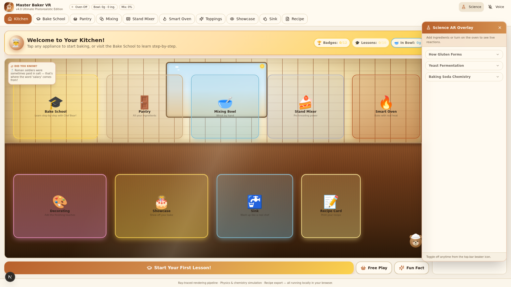

# 🧑‍🍳 Master Baker VR — Virtual Baking Kitchen for Kids

A photorealistic, interactive virtual baking kitchen that teaches kids real cooking science through play. Built with Next.js 16, TypeScript, Tailwind CSS, and Framer Motion. Designed for desktop and iPad (touch-friendly).

> **Ages 7+** · Learn kitchen science, earn badges, and bake amazing treats — all in your browser.



---

## ✨ Features

### 🏠 Virtual Kitchen Bench
The app opens on a **unified 3D-perspective kitchen scene** showing all 9 appliances at once on a wooden counter — like walking into a real kitchen. Tap any appliance to jump in:
- Back wall with subway-tile pattern + window with animated sun and drifting clouds
- Counter top with realistic wood grain texture
- 9 clickable appliance hotspots with live state badges (🔥 Baking, ✓ Served, gram counts)
- Welcome banner with progress pills (Badges X/12, Lessons X/10, In Bowl Xg)
- **Chef Bear mascot** in the corner (animated, clickable for tips)
- Rotating "Did you know?" fun fact badge (15 kid-friendly facts)

### 🎓 Bake School (10-Lesson Curriculum)
A full progressive curriculum designed like a kids' cooking class:

| # | Lesson | Difficulty | Topic |
|---|--------|-----------|-------|
| 1 | 🥄 First Mix | ★ | Flour + water = dough |
| 2 | 🍯 Sweet Sugar | ★ | How sugar dissolves |
| 3 | 🧈 Butter & Eggs | ★★ | Fats + emulsifiers |
| 4 | 🦠 Yeast Alive! | ★★★ | Living fungus makes bread rise |
| 5 | 🔥 First Bake | ★★★ | Oven + Maillard reaction |
| 6 | 🫧 Bubble Magic | ★★★ | Baking soda + acid chemistry |
| 7 | 🎨 Cake Decorator | ★★ | Decorating with toppings |
| 8 | 🤝 Customer Service | ★★ | Presentation + feedback |
| 9 | 🍫 Chocolate Lab | ★★★★ | Complex recipe following |
| 10 | 👑 Master Baker | ★★★★★ | Final exam — signature bake |

Each lesson has:
- Step-by-step instructions in kid-friendly language
- Chef Bear hints for each step
- A **fun fact** unlocked when the step completes
- Auto-navigation to the correct station
- Auto-advance when the kid's actions meet the step's check predicate
- Progressive unlock (must complete previous to unlock next)

### 🏆 Achievement Badges (12 Unlockable)
| Badge | How to unlock |
|-------|---------------|
| 🌾 First Scoop | Add your first ingredient |
| 🌀 Mixing Master | Whisk to 50% combined |
| 💪 Gluten Builder | Knead to 50% gluten development |
| 🔥 First Bake | Complete a bake cycle |
| ✨ Golden Crust | Reach golden browning (50-85%) |
| 🎨 Cake Decorator | Add 3+ toppings |
| 😊 Happy Customer | Serve first bake to customer |
| ⭐ Five-Star Baker | Earn 5-star customer rating |
| 🔬 Kitchen Scientist | View 5 science AR notes |
| 🎓 Lesson 1 Graduate | Complete first lesson |
| 🍞 Bread Apprentice | Complete 5 lessons |
| 👑 Master Baker | Complete all 10 lessons |

Badges auto-unlock as kids bake. The Bake School shows a badge grid with locked badges greyed out.

### 🧑‍🍳 Stations

1. **🚪 Pantry** — 23 ingredients across 7 categories (dry, wet, fats, leavening, eggs, dairy, flavors) with quantity picker
2. **🥣 Mixing** — Ceramic bowl with layered ingredient rendering, live whisk animation, flour-dust particles, real-time mix-level homogenization
3. **🍰 Stand Mixer** — Custom SVG of polished-steel mixer with rotating dough hook, speed dial, gluten-development meter, windowpane test indicator
4. **🔥 Smart Oven** — HD brushed stainless steel with glowing heating elements, heat-haze, steam particles, real-time rising + Maillard browning simulation, 4 modes (bake/fan/broil/proof)
5. **🎨 Toppings** — 23 topping materials with 6 application methods (dust, drizzle, pipe, scatter, layer, place). Touch-friendly Pointer Events for iPad
6. **🎂 Showcase** — Customer display case with cake on glass pedestal, slice selector (4/6/8/10/12), serve-to-customer with confetti celebration, auto-generated customer rating + review
7. **🚰 Sink** — SVG sink with running water, ripples, soap-suds animation, auto-scrub loop
8. **📝 Recipe Exporter** — Printable recipe card with grams + ounces, hydration analysis, fat/sugar/leavening breakdown, print + .txt save

### 🎙️ Voice Assistant
Web Speech API integration — say things like:
- "Open pantry"
- "Set oven to 180 degrees"
- "Set timer for 25 minutes"
- "Switch to broil"
- "Turn oven on/off"

### 🔬 Science AR Overlay
Toggleable scientific explanations for what's happening in your kitchen:
- How gluten forms
- Yeast fermentation (with chemical equation)
- Baking soda chemistry
- Maillard browning
- Oven heat transfer (radiation + convection + conduction)
- …and more

### 🐻 Chef Bear Mascot
A custom SVG cartoon bear in a chef hat that pops up with speech bubbles for:
- Lesson start
- Fun facts
- Badge unlocks
- Lesson completion

### 🎉 Celebration System
- Lesson-complete confetti overlay (30 falling particles)
- "Served to Customer" confetti on the showcase
- "FRESH!" ribbon on served cakes
- Auto-customer rating based on bake quality

---

## 🛠️ Tech Stack

- **Framework**: Next.js 16 with App Router
- **Language**: TypeScript 5
- **Styling**: Tailwind CSS 4 + shadcn/ui (New York style)
- **Animations**: Framer Motion
- **State**: Zustand
- **Icons**: Lucide React
- **Voice**: Web Speech API
- **Fonts**: Geist Sans + Geist Mono

### Graphics & Materials
Custom HD-grade PBR-style shaders built with pure CSS:
- Multi-layer brushed stainless steel (4 gradient layers + anisotropic highlights + brushed grain)
- Ceramic with subsurface scattering hint + fresnel rim + 6-layer contact shadows
- Glass with multi-layer reflections
- Procedural wood/marble counter textures
- Film grain overlay (cinematic feel)
- Volumetric sunbeams + spotlight cones

---

## 🚀 Getting Started

### Prerequisites
- Node.js 18+ (or Bun)
- npm/bun/pnpm

### Install & Run

```bash
# Install dependencies
bun install
# (or npm install)

# Start the dev server
bun run dev
# (or npm run dev)

# Open http://localhost:3000
```

### Build for Production

```bash
bun run build
bun run start
```

---

## 📁 Project Structure

```
src/
├── app/
│   ├── globals.css          # HD material library + film grain + theme
│   ├── layout.tsx           # Root layout with iOS/iPad viewport meta
│   └── page.tsx             # Renders <KitchenApp />
├── components/
│   ├── kitchen/
│   │   ├── KitchenApp.tsx           # Main shell with station tabs
│   │   ├── KitchenBench.tsx         # Unified kitchen scene + Chef Bear mascot
│   │   ├── BakeSchoolStation.tsx    # Lesson list + active lesson view
│   │   ├── MascotOverlay.tsx        # Speech bubble + celebration modal
│   │   ├── PantryStation.tsx        # Ingredient picker
│   │   ├── MixingStation.tsx        # Bowl + whisk
│   │   ├── StandMixerStation.tsx    # Pro stand mixer SVG
│   │   ├── OvenStation.tsx          # HD photoreal oven
│   │   ├── ToppingsStation.tsx      # Touch-friendly decorating canvas
│   │   ├── ShowcaseStation.tsx      # Customer display case
│   │   ├── SinkStation.tsx          # Cleanup station
│   │   ├── RecipeExporter.tsx       # Printable recipe card
│   │   ├── VoiceAssistant.tsx       # Web Speech API integration
│   │   ├── ScienceOverlay.tsx       # AR science notes
│   │   └── BowlView.tsx             # Reusable bowl visualizer
│   └── ui/                  # shadcn/ui components
├── hooks/
│   ├── use-mounted.ts       # Hydration-safe mounted gate
│   └── use-lesson-tracker.ts # Auto-advances lessons + unlocks badges
└── lib/
    ├── ingredients.ts       # 23-ingredient library
    ├── toppings.ts          # 23-topping library
    ├── science.ts           # 10 science AR notes
    ├── lessons.ts           # 10-lesson curriculum + 12 badges + 15 fun facts
    └── kitchen-store.ts     # Zustand store with all kitchen state
```

---

## 🍎 iPad / iOS Compatibility

- `viewport` meta with `viewportFit: "cover"` for safe-area awareness
- `appleWebApp` metadata (capable, title, status bar style)
- All interactive elements meet 44px+ touch target minimum
- `touch-action: none` on canvas elements to prevent scroll
- `-webkit-tap-highlight-color: transparent`
- Pointer Events API (works identically for touch and mouse)

---

## 🎯 Learning Goals

This app teaches kids:
- **Kitchen science**: gluten formation, yeast fermentation, Maillard browning, emulsification, leavening chemistry
- **Math & measurement**: weighing ingredients in grams, hydration ratios, oven temperature conversion (C/F)
- **Sequencing & following instructions**: step-by-step recipe execution
- **Fine motor skills**: dragging toppings, decorating cakes
- **Cause and effect**: ingredient choices → bake outcomes
- **Customer empathy**: presenting work, receiving feedback, iterating

---

## 📸 Screenshots

See the [`download/screenshots/`](download/screenshots/) directory for HD screenshots of every station.

---

## 📄 License

MIT — free for educational and personal use.

---

## 🙏 Acknowledgements

Built with the [Z.ai](https://z.ai) fullstack development platform.
